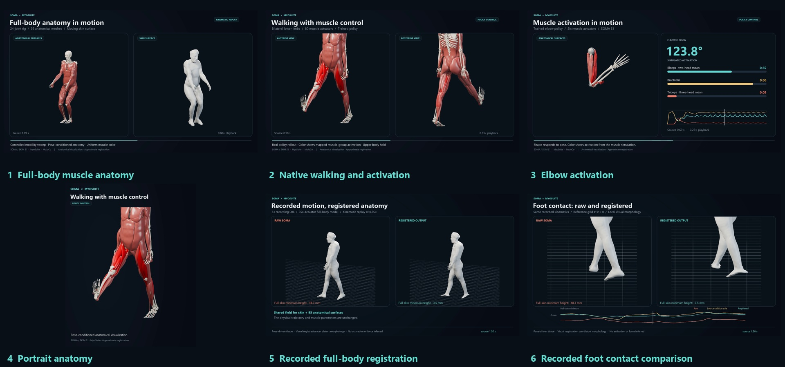

# MyoSuite–SOMA

[](https://github.com/M-Colley/myosuite-soma/actions/workflows/ci.yml)

**Pose-dependent 3D muscle and skin anatomy for MuJoCo and MyoSuite.**

An independent, experimental integration of [SOMA](https://vcai.mpi-inf.mpg.de/projects/SOMA/) with musculoskeletal simulation. The standalone backend predicts and caches anatomy; a small optional adapter connects it to MyoSuite's existing USD/Blender renderer.



[Download six demonstration videos](https://github.com/M-Colley/myosuite-soma/releases/tag/v0.1.0a1) · [Validation and limits](validation/REPORT.md) · [Integration guide](integration/README.md)

## What it provides

- Subject-matched released SOMA inference for skin and individual anatomical surfaces.
- Named skeletal calibration, world placement and bounded recorded-motion retargeting.
- Optional shared anatomical registration and native-foot visual contact corrections.
- Experimental physiology-conditioned geometry training/inference with a synthetic-data gate.
- Numeric NPZ and chunked caches, optional bounded-error compression, standalone USD export.
- Explicit source-model, trajectory and conditioning provenance checks.

The released model is pose-driven. Its surfaces provide visual anatomy while MyoSuite supplies native motion and physiology. The integration leaves source strength, optimal fibre length, tendon slack length, joints, masses and collision mechanics unchanged.

## Install

Use Python 3.10 or newer in a virtual environment:

```sh
git clone https://github.com/M-Colley/myosuite-soma.git
cd myosuite-soma
python -m pip install -e ".[inference,render,myosuite]"
myosuite-soma doctor
```

For only cache/configuration/geometry APIs, install `.` without extras. Torch is needed for inference; MyoSuite and USD support are optional. Blender is installed separately. The `[benchmark]` extra adds process-memory measurements; `[test]` adds developer tools.

### Release assets

Obtain SKIM v2 subject assets and the matching main/rigid RELEASE_V2 checkpoints through the [SOMA authors' release instructions](https://github.com/edualvarado/SOMA#data-preparation). They are downloaded separately and are not bundled here. Each subject needs its own rig, topology, main checkpoint and rigid checkpoint.

Copy an example JSON to a local configuration, then set `data_root` and `checkpoint`. Example relative paths resolve against the configuration's directory. S1 calibration examples target the documented exact MyoSuite models; they are not universal anatomical calibration.

### MyoSuite rendering adapter

Upstream MyoSuite needs the supplied adapter before `render` accepts SOMA inputs. The adapter is tested against dev commit `c0af9c656de2aa1807924e63d0d5320d77aa1ebd`:

```sh
git clone https://github.com/MyoHub/myosuite.git ../myosuite
git -C ../myosuite checkout c0af9c656de2aa1807924e63d0d5320d77aa1ebd
python -m pip install -e ../myosuite
myosuite-soma install-adapter --myosuite-source ../myosuite --check
myosuite-soma install-adapter --myosuite-source ../myosuite
myosuite-soma render --help
```

`install-adapter` checks the patch before changing any source. It does not modify installed site-packages or apply at import time. Newer MyoSuite revisions must pass the explicit patch check and need their own validation. The integration changes three upstream files; the inference and research code stays in this package.

With licensed assets configured:

```sh
myosuite-soma render --env myoElbowPose1D6MFixed-v0 --random --seed 0 --seconds 0.4 --soma-config local-soma.json --output renders/elbow --export-only --muscle-color uniform
```

Omit `--export-only` and pass `--blender /path/to/blender` to render. Use a fresh output directory. Full-body examples additionally require the matching `musclemimic_models==1.0.6` model package.

## Standalone APIs and commands

```python
from myosuite_soma.soma import generate_animation, save_animation

# model is a MuJoCo MjModel; arrays are synchronized recorded native states.
animation = generate_animation(
    "local-soma.json", model, qpos, time, actuator_names, activation,
    physiology=physiology,
)
save_animation("anatomy.npz", animation)
```

```sh
myosuite-soma cache anatomy.npz anatomy.chunks --chunk-frames 16 --max-error-mm 0.1
myosuite-soma export-usd anatomy.npz anatomy.usdc
myosuite-soma retarget --help
myosuite-soma conditioning --help
myosuite-soma benchmark --help
```

The retargeter accepts either a standalone MuJoCo XML `--model` or an optional MyoSuite `--env`. Recording rotation packing and root conventions are explicit separate inputs. Recorded replay produces kinematics; it infers no activation or control policy.

`AnimationArchive.iter_chunks()` has bounded-memory reads. USD/Blender export currently materializes the animation. This is an offline visualization pipeline.

## Validation and remaining limits

The precursor implementation was compared with released SOMA equations on **390 poses spanning all 74 recordings across S1–S5**. Maximum coordinate differences were below **0.0006 mm for skin** and **0.0008 mm for individual surfaces**. These measure equation parity, not anatomical truth. The standalone extraction has its own package-level tests and real-asset parity checks recorded in [`validation/`](validation/).

Registration is opt-in. Longer S2–S5 checks covered 1,192 source states with finite geometry and unchanged source parameters. Walking withheld-knee errors improved for all four, but full-body withheld errors worsened for S2–S4; S5 walking retained **88.52 mm** of residual skin penetration. Bounded local correction does not establish incompressibility, pressure or globally intersection-free anatomy.

Physiology-conditioned geometry is implemented as a research extension. Its supplied demonstration has fabricated targets on real topology; measured matched-pose tissue geometry under different loads is still needed for physiological validation. Muscle-head and tendon correspondences remain subject to anatomical review.

## Development

```sh
python -m pip install -e ".[inference,render,test]"
python -m pytest
python -m ruff check src tests
python -m ruff format --check src tests
python -m build
python -m twine check dist/*
```

CI covers synthetic fixtures without downloading private datasets or model weights. Local real-asset studies are distinguished from hosted CI results. This repository does not publish packages to PyPI automatically.

## Attribution

SOMA/SKIM: Eduardo Alvarado and the SOMA authors, *SOMA: From Surface Observations to Muscle Anatomy*, ECCV 2026. [Original source](https://github.com/edualvarado/SOMA).

MyoSuite/MyoSim/MuJoCo supply the musculoskeletal models and simulation; Blender supplies rendering. Adapted source retains its original notices. See [THIRD_PARTY_NOTICES.md](THIRD_PARTY_NOTICES.md) and [LICENSE](LICENSE). Release assets retain their separately distributed terms.
